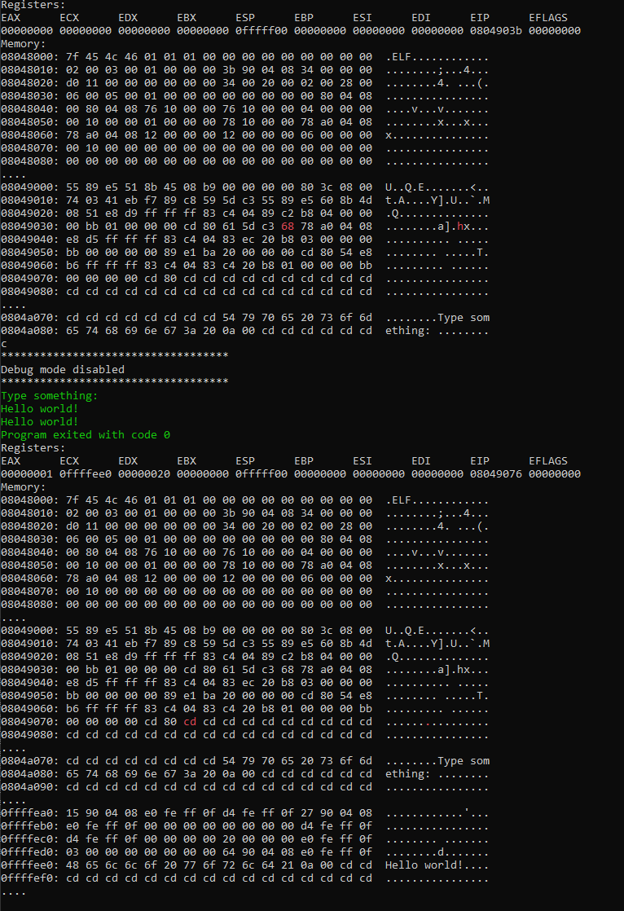

# x86 virtual machine

## Build and run
```sh
mkdir build
cd build
cmake ..
make
./vxm86
```

## About
This is a simple x86 virtual machine that runs Linux programs with support for ELF executables.
The VM supports step-by-step instructions execution with visualization of the memory and registers.

## Example
The screenshot below shows an initial and a final state of the VM with a sample program loaded into memory.
The green text is an input/output of the running program.
The sample program reads a string from the user and prints it back.


